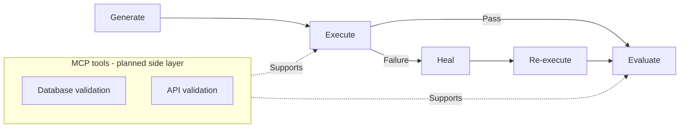

# AEGIS

### Agentic E2E Generation, Intelligent Evaluation & Self-healing

**A protective quality layer that helps teams generate, repair, and evaluate software tests—including AI outputs.**

> **Project status:** The current repository contains my standalone learning projects. The integrated AEGIS framework and the capabilities below are planned; they are not presented as shipped functionality.

## Why AEGIS?

Traditional end-to-end suites can become brittle as applications change, and keeping them reliable takes substantial maintenance. Meanwhile, conventional assertions cannot tell teams whether an LLM response is useful, grounded, or consistent with expectations. AEGIS is designed to generate Playwright tests from requirements, then use agentic workflows to diagnose and heal failures. It also plans to evaluate LLM outputs and expose MCP tools for database and API validation. The goal is a more adaptive quality layer that supports both application behavior and AI-powered features.

## Why I Chose the Name AEGIS

“Aegis” is an English word meaning protection, safeguarding, or backing. That meaning reflects QA’s role: a protective layer that helps guard software releases against defects and regressions.

| Letter | Capability | Technology |
|---|---|---|
| **A** | Agentic orchestration | LangGraph and LangChain |
| **E** | End-to-end validation | Playwright |
| **G** | Generation of test scenarios and scripts | TypeScript and Playwright |
| **I** | Intelligent evaluation of LLM outputs | LLM-as-judge workflows with LangChain |
| **S** | Self-healing test execution | Playwright with LangGraph orchestration |

The name suits an autonomous quality system because AEGIS is intended to provide ongoing protection, not just a one-time test run. Its agents are planned to respond to application changes, recover from test failures, and evaluate AI behavior as part of the quality process.

## Project Origins

I started with standalone learning projects covering LLM basics and prompt engineering, then explored Claude skills such as a test-plan creator and an API response validator. I’m bringing those experiments together into AEGIS: a framework for applying agentic workflows to software quality.

## Prompt Engineering: RICEPOT Method

RICEPOT is a structured prompt format explored as implemented learning work; it is not part of the planned AEGIS framework.

| Part | Purpose |
|---|---|
| **R — Role** | Who the AI acts as |
| **I — Instructions** | The task and mandatory or forbidden rules |
| **C — Context** | The application and environment |
| **E — Example** | A structure-only sample of the expected code |
| **P — Parameters** | Configuration, dependencies, and constraints |
| **O — Output** | Exactly what to return and in what format |
| **T — Tone** | The style of the response |

A safety and anti-hallucination block at the end prohibits invented selectors or messages, requires each assertion to be traceable to the reference file, and reports missing information instead of guessing. In practice, the prompt guides GitHub Copilot in Agent mode to generate a Playwright + TypeScript project for the Wingify login page, using a separate file of captured element HTML as its only source of truth.

The project demonstrates the Page Object Model, Allure reporting, review of existing files before generation, and a deterministic self-healing locator utility with ordered fallback locators. Each heal is reported, and assertions are never healed. This rule-based healing is a precursor to the agentic self-healing planned for AEGIS. The prompt, reference folder, and generated project are in `Prompt-Engineering/RICEPOT/`.

## Features

- **Planned** — Autonomous generation of Playwright end-to-end tests.
- **Planned** — Self-healing execution that diagnoses failures and retries with repaired tests.
- **Planned** — LLM output evaluation using an LLM-as-judge approach.
- **Planned** — MCP tools for database and API validation.

## Architecture Overview

The following diagram describes the planned workflow. MCP tools are a supporting layer for database and API checks.

## Roadmap

- [x] **Done:** Explored structured prompting (RICEPOT) to generate a Playwright project with Allure reporting and rule-based self-healing locators.
- [ ] **Planned:** Define the framework interfaces and connect the standalone learning work.
- [ ] **Planned:** Generate Playwright tests from test plans and application context.
- [ ] **Planned:** Add failure analysis and self-healing test execution.
- [ ] **Planned:** Add LLM-as-judge evaluation for AI-generated outputs.
- [ ] **Planned:** Provide MCP tools for database and API validation.

## Technology Notes

The core framework is planned around TypeScript, Playwright, LangChain, LangGraph, and MCP. CrewAI is Python-based, so it is considered an optional integration rather than a core TypeScript dependency.

## Author

- **Name:** Satyaprakash Pani
- **LinkedIn:** www.linkedin.com/in/satyaprakaashpani
- **GitHub:** [Your GitHub profile](https://github.com/your-username)
